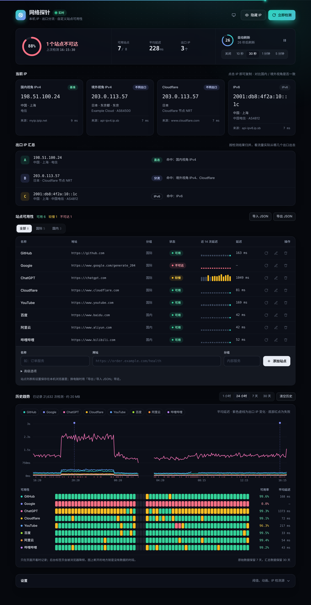
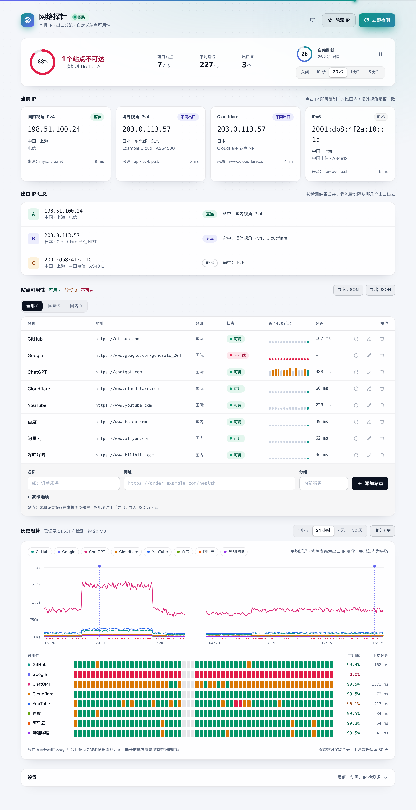

# 网络探针 net-probe

一个纯前端的网络自检小工具：**一个 `index.html`，没有依赖，不用构建**。双击打开，或者丢到任意静态托管上就能用。

它从「当前这台电脑、当前这条网络」的视角回答三个问题：

1. **我现在的 IP 是什么？** 同时查国内视角、境外视角、Cloudflare、IPv6 几个检测源，看看它们是否一致。
2. **流量从哪几个出口出去？** 把所有检测结果按 IP 归并成出口列表，标出哪个是直连、哪个是分流。
3. **我们关心的站点现在能不能访问？** 站点可以自己添加、分组、编辑、删除，列表保存在浏览器本地。

## 预览

<table>
  <tr>
    <th>深色</th>
    <th>浅色</th>
  </tr>
  <tr>
    <td></td>
    <td></td>
  </tr>
</table>

> 截图里的 IP 都是文档保留地址，网络请求和历史数据都是模拟的，只用来展示界面。主题默认跟随系统，右上角的按钮可以在「跟随系统 / 浅色 / 深色」之间切换。

## 功能

- 总览：可用率环形图、可用站点数、平均延迟、出口数量，一眼看清整体状态
- 自动刷新：可选关闭 / 10 秒 / 30 秒 / 1 分钟 / 5 分钟，支持暂停；顶部进度条和倒计时环按帧连续变化，检测中切换成流光效果
- 每个站点保留最近 14 次延迟，画成小柱状图，鼠标悬停可以看到每次的时间和延迟；刷新页面后会从历史里补回来
- 历史趋势：每次检测都存进浏览器（IndexedDB），可以看最近 1 小时 / 24 小时 / 7 天 / 30 天
  - 延迟折线图：多站点叠加，悬停时有十字线并列出该时段各站点的平均延迟；点图例可以显示 / 隐藏，双击图例只看这一个
  - 出口 IP 变化会在图上画成紫色竖线，悬停可以看到「什么时候、从哪个 IP 换成了哪个」
  - 可用性色块：每个站点一行，绿 / 黄 / 红分别表示正常 / 较慢或偶有失败 / 失败较多，右侧是该时段的可用率和平均延迟
  - 没有数据的时段（页面没开、标签页被降频）会断开显示，不会把两端硬连起来
- 动效：入场时依次淡入，IP 以「解码」方式出现，数字会滚动变化，状态切换有弹性过渡，分组和间隔切换时有滑块跟随（都可以在设置里关闭；系统开启「减少动态效果」时会自动关闭）
- 指针交互：面板随指针出现聚光，按钮有轻微磁吸效果，跟随指针的光圈会随悬停对象变形（可在设置里关闭，触屏设备不显示），截断的文字悬停时会显示完整内容
- 主题默认跟随系统（系统切换深浅色时会实时跟着变），也可以手动固定为浅色或深色；点击 IP 即可复制
- 一键隐藏 IP，方便截图（图表里 IP 变化的提示也会一起打码）
- 导入 / 导出 JSON 配置，换电脑或者分享给同事都很方便；在设置里勾选后，导出时可以带上历史数据
- 可以调较慢阈值、超时时间、逐个检测间隔，IP 检测源也可以自定义

## 使用

```bash
# 直接打开
open index.html

# 或者起个静态服务
python3 -m http.server 8080
```

## 检测原理与限制

浏览器有跨域限制，所以纯前端能做的事情有边界：

| 检测方式 | 能拿到什么 | 适用 |
| --- | --- | --- |
| 仅连通性（默认，`no-cors`） | 通 / 不通、耗时；**拿不到状态码** | 任何站点 |
| 读取状态码（`cors`） | 真实 HTTP 状态码 | 需要站点返回 `Access-Control-Allow-Origin` |

- 耗时是浏览器 `fetch` 的总耗时，第一次请求会包含 DNS 解析和 TLS 握手，所以通常偏高。
- 页面通过 HTTPS 打开时，`http://` 的站点会被浏览器当作混合内容拦截，结果会显示为不可达。
- **单个站点走的是哪个出口，浏览器本身是不知道的。** 只有在给站点配置了「IP 回显接口」（返回访问者 IP 的地址）时才能判断。我们自己的服务可以加一个，例如：
  - 套了 Cloudflare 的站点：`/cdn-cgi/trace`（需要额外加跨域响应头）
  - 自己写一个 `/whoami`，返回 `{"ip":"..."}`，并允许跨域

  回显接口的返回内容支持三种格式：JSON 里的 `ip` 字段、`ip=...` 文本、或任意包含 IP 的纯文本。

## 历史数据

| 数据 | 内容 | 保留时间 |
| --- | --- | --- |
| 原始记录 | 每次检测一条：站点、时间、延迟、状态 | 7 天 |
| 汇总记录 | 每个站点每 5 分钟一条：检测次数、成功次数、较慢次数、延迟列表 | 30 天 |
| 出口变化 | 检测源或 IP 回显接口返回的 IP 变化 | 30 天 |

- 1 小时和 24 小时视图读原始记录，7 天和 30 天视图读汇总记录；过期数据在打开页面时和之后每小时清理一次。
- 数据存在当前浏览器的 IndexedDB 里，换浏览器或清除网站数据就没了；隐私模式下可能不可用。
- **只有页面开着时才会记录。** 浏览器会给后台标签页降频，所以长时间放在后台会有空档。它适合「开着页面观察一段时间」；如果需要 7×24 小时不间断监控，还是得用服务端来跑。
- 删除站点时会一起删掉它的历史；「清空历史」会删掉全部记录。

## 配置格式

导出的 JSON 大致如下，手动编辑后再导入即可：

```json
{
  "version": 1,
  "interval": 30,
  "slowMs": 1000,
  "timeoutMs": 8000,
  "stagger": 60,
  "motion": true,
  "halo": true,
  "theme": "system",
  "themeSet": false,
  "histRange": "24h",
  "exportHistory": false,
  "geoLookup": "https://api.ip.sb/geoip/{ip}",
  "ipSources": [
    { "id": "cn", "label": "国内视角 IPv4", "url": "https://myip.ipip.net/json", "parse": "ipip", "base": true }
  ],
  "sites": [
    {
      "name": "订单服务",
      "url": "https://order.example.com/health",
      "group": "内部服务",
      "mode": "cors",
      "echo": "https://order.example.com/whoami"
    }
  ]
}
```

- `ipSources[].parse` 可选：`ipsb`、`ipip`、`cftrace`、`ipapi`、`ipify`、`text`（从文本里找出第一个 IP）。
- `base: true` 表示这个检测源作为「直连」基准。其他检测源返回的 IP 如果和它不同，会标记为「不同出口」。
- `family: "v6"` 表示这是 IPv6 检测源，不参与和基准的比较。
- `geoLookup` 用来查询出口 IP 的归属地，`{ip}` 会被替换成具体 IP，返回格式需要和 ip.sb 一致。
- `theme` 可选 `system` / `light` / `dark`；只有 `themeSet` 为 `true` 时才使用 `theme` 的值，否则一律跟随系统。
- 勾选「导出时包含历史数据」后，导出的文件会多一个 `history` 字段；导入这样的文件时会询问是否用它替换本机历史。

默认的第三方检测源（ipip.net、ip.sb、Cloudflare）是否允许跨域、能否访问，取决于对方服务和你所在的网络。哪个用不了，在设置里换掉就行。
